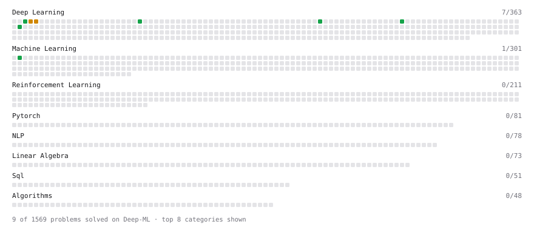

# Deep-ML

My machine learning practice from [Deep-ML](https://www.deep-ml.com). Every solution here was written by hand.

**5** solved · 4 problems · 1 labs · 0 math

[**Browse the interactive portfolio**](https://tokhirasulov.github.io/deep-ml/) to replay this filling in over time.

## Problems

| | Difficulty | Solved | |
| --- | --- | --- | --- |
| [Derivatives of Activation Functions](https://www.deep-ml.com/problems/217) | easy | 2026-10-09 | [solution](problems/0217-derivatives-of-activation-functions) |
| [Implement the Softplus Activation Function](https://www.deep-ml.com/problems/99) | easy | 2026-10-09 | [solution](problems/0099-implement-the-softplus-activation-function) |
| [Implement the Tanh Activation Function](https://www.deep-ml.com/problems/264) | easy | 2026-10-08 | [solution](problems/0264-implement-the-tanh-activation-function) |
| [Implementing Basic Autograd Operations](https://www.deep-ml.com/problems/26) | medium | 2026-10-09 | [solution](problems/0026-implementing-basic-autograd-operations) |

## Labs

| | Difficulty | Solved | |
| --- | --- | --- | --- |
| [PyTorch: Build a Complete Training Loop](https://www.deep-ml.com/labs/13) | easy | 2026-10-11 | [solution](labs/0013-pytorch-build-a-complete-training-loop) |

---

_This file is regenerated by Deep-ML on every push._
